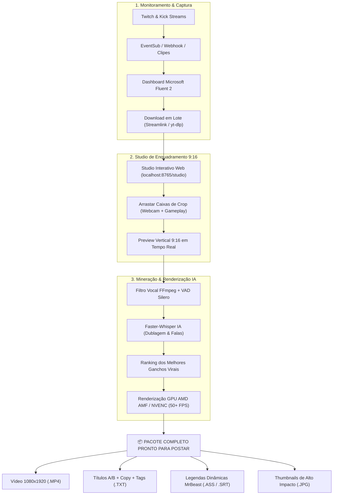

# 🎬 Cortes IA Pro & Monitoramento LIVE (Twitch & Kick)

> **Plataforma Completa e Autônoma para Mineração, Enquadramento Vertical 9:16, Transcrição Vocal por IA e Edição de Cortes Virais Acelerada por GPU.**

[](https://www.python.org/downloads/)
[](https://fastapi.tiangolo.com/)
[](https://github.com/SYSTRAN/faster-whisper)
[](https://ffmpeg.org)
[](LICENSE)

---

## 📌 Visão Geral

O **Cortes IA Pro** é um ecossistema projetado para criadores de conteúdo, streamers e canais de cortes que desejam transformar transmissões longas, podcasts e gameplays em vídeos curtos de altíssima retenção (**YouTube Shorts, TikTok, Instagram Reels e Kwai**).

O projeto é estruturado em **3 pilares principais**:



---

## ⚡ Início Rápido em 1 Clique (Zero Configuração no Windows)

Qualquer usuário no Windows pode simplesmente dar **dois cliques** no painel central ou no executável desejado:

### Opção 1: Painel Central Unificado (Recomendado)
Execute com dois cliques:
```cmd
0_INICIAR_AQUI.bat
```
> **O que ele faz automaticamente:**  
> 1. Realiza uma **varredura rápida** de integridade do ambiente;  
> 2. Se for a primeira execução, cria o ambiente virtual `.venv`, instala o Python/FFmpeg caso necessário e baixa todas as dependências;  
> 3. Nas próximas vezes, valida tudo em menos de 1 segundo e exibe o menu para você escolher qualquer ferramenta com 1 tecla!

---

### Opção 2: Acesso Direto aos Módulos Individuais

Todos os arquivos `.bat` possuem auto-recuperação: se a máquina for nova, eles instalam tudo automaticamente antes de abrir a janela!

| Arquivo `.bat` | Função | Descrição |
| :--- | :--- | :--- |
| **`0_INICIAR_AQUI.bat`** | **Painel Central** | Menu interativo com auto-varredura para escolher qualquer módulo com 1 clique. |
| **`INICIAR_INTERFACE_GRAFICA.bat`** | **App Desktop (CustomTkinter)** | Ferramenta manual de geração de clipes com seleção visual dos 5 layouts, enquadramentos e barra de progresso. |
| **`1_MONITORAMENTO_LIVE.bat`** | **Monitoramento de Lives** | Abre o painel nativo Fluent 2 para monitorar Twitch e Kick ao vivo, baixar clipes sem censura de espectadores e streams completas. |
| **`2_STUDIO_CROP_CAPTURA.bat`** | **Studio de Enquadramento** | Abre o Studio Web (`http://127.0.0.1:8765/studio`) para ajustar visualmente as caixas de webcam e gameplay com preview instantâneo 9:16. |
| **`3_DOWNLOAD_E_MINERADOR.bat`** | **Mineração Automática** | Arraste e solte qualquer vídeo (.mp4/.mkv/.ts) para minerar os momentos virais com Whisper + Silero VAD e renderizar via GPU. |
| **`INSTALAR_DEPENDENCIAS.bat`** | **Instalador e Reparador** | Script autônomo para varrer, reparar e atualizar bibliotecas a qualquer momento. |

---

## 🎨 5 Modos de Layout e Enquadramento

1. **Fundo Desfocado Moderno (`BLUR_BACKGROUND`):** Vídeo centralizado em Full HD com faixas superior e inferior preenchidas pelo próprio vídeo em desfoque cinemático (Gaussian blur com -15% de brilho). Ideal para filmes, trailers e videoclipes.
2. **Split Screen (`SPLIT_SCREEN`):** Webcam no terço superior (38%) e Gameplay no terço inferior (62%). Padrão consagrado para streamers.
3. **Tela Cheia Adaptativa (`FULL_BLEED_ZOOM`):** Preenche 100% da tela do celular sem bordas pretas com zoom adaptativo focado na ação.
4. **Dual Focus (`DUAL_FOCUS`):** Divisão para podcasts e entrevistas com foco simultâneo em duas pessoas.
5. **Studio Interativo (`STUDIO`):** Enquadramento 100% personalizado com coordenadas manuais definidas pelo Studio Web.

---

## 🧠 Inteligência Artificial de Áudio e Retenção

- **Faster-Whisper IA:** Transcrição precisa com modelo `medium` (padrão de estúdio em português) ou `base`.
- **Silero VAD (Voice Activity Detection):** Filtra respirações, silêncios mortos (> 0.5s) e ruídos de fundo.
- **Áudio Ducking Automático:** Reduz suavemente a música de fundo durante as falas dos participantes.
- **Legendas MrBeast:** Fonte Komika Axis com contorno preto espesso (6px), realce amarelo vibrante e animações dinâmicas de punch-in.
- **Copywriting Multiplataforma:** Gera automaticamente 3 opções de títulos para teste A/B de CTR, roteiro de postagem para YouTube Shorts, TikTok e Kwai, além de uma pool rotativa de hashtags não-repetitivas.

---

## 📁 Estrutura do Repositório

```plaintext
GitHub/
├── 1_MONITORAMENTO_LIVE.bat        # Lançador do Painel Twitch & Kick
├── 2_STUDIO_CROP_CAPTURA.bat       # Lançador do Studio Web 9:16
├── 3_DOWNLOAD_E_MINERADOR.bat      # Lançador de Mineração & Drag-and-Drop
├── INICIAR_INTERFACE_DESKTOP.bat   # Interface Desktop CustomTkinter
├── INSTALAR_DEPENDENCIAS.bat       # Instalador automático com 1 clique
├── gui_cortes.py                   # Código da interface gráfica desktop
├── minerar_live.py                 # Script CLI de mineração e downloads
├── yunet.onnx                      # Rede neural leve para detecção facial
├── requirements.txt                # Dependências Python oficiais
├── .gitignore                      # Filtro para ignorar arquivos de vídeo/áudio
├── README.md                       # Documentação completa
│
├── core/                           # Módulo central de processamento
│   ├── audio_analyzer.py           # Silero VAD, decibéis e ducking de áudio
│   ├── config.py                   # Configurações globais e detecção de GPU
│   ├── content_classifier.py       # Nichos (Games, Podcasts, Cinema, Música)
│   ├── hook_generator.py           # Algoritmo de ranking de ganchos virais
│   ├── pipeline.py                 # Orquestrador do pipeline de ponta a ponta
│   ├── renderer.py                 # Renderizador GPU AMF / NVENC
│   ├── subtitles.py                # Gerador de legendas dinâmicas ASS e SRT
│   └── vision.py                   # Rastreamento facial com YuNet e OpenCV
│
├── Monitoramento LIVE/             # Módulo Web & Servidor FastAPI
│   ├── iniciar_servidor.py         # Launcher em janela nativa (App Mode)
│   ├── config.json                 # Configurações de streamers e portas
│   ├── backend/                    # APIs Twitch, Kick, Downloader e Studio
│   ├── templates/                  # Interfaces HTML5 (Dashboard e Studio)
│   └── static/                     # Folhas de estilo CSS e JavaScript
│
├── assets/layouts/                 # Imagens de preview dos layouts visuais
├── skill/                          # Definição de Skill para Agentes de IA
│   └── SKILL.md                    # Instruções padronizadas para agentes
└── .agents/skills/                 # 8 Sub-skills modulares especializadas
```

---

## 🤖 Integração como Skill para Agentes de IA

Este repositório possui suporte nativo ao padrão de **Skills do Antigravity**. Qualquer agente autônomo pode ler a pasta `skill/SKILL.md` para entender como orquestrar chamadas de mineração, renderização de cortes e geração de legendas programaticamente.

Exemplo de chamada direta via Python:
```python
from pathlib import Path
from core.pipeline import processar_video_completo

resultado = processar_video_completo(
    caminho_video=Path("meu_video.mp4"),
    qtd_cortes=5,
    duracao_corte=60.0,
    gerar_legendas=True,
    whisper_model="medium",
    layout_tipo="BLUR_BACKGROUND"
)
```

---

## 📋 Pré-requisitos de Sistema

- **Sistema Operacional:** Windows 10/11 ou Linux.
- **Python:** Versão 3.10 ou superior.
- **FFmpeg:** Obrigatório no PATH do sistema (`ffmpeg -version`).
- **Placa de Vídeo (Opcional, mas Recomendada):**
  - AMD: Radeon RX com suporte a AMF (`h264_amf`)
  - NVIDIA: GeForce GTX/RTX com suporte a NVENC (`h264_nvenc`)
  - *(Fallback automático para CPU x264 caso não haja GPU dedicada)*.

---

## 📄 Licença
Distribuído sob a licença MIT. Consulte `LICENSE` para mais detalhes.
