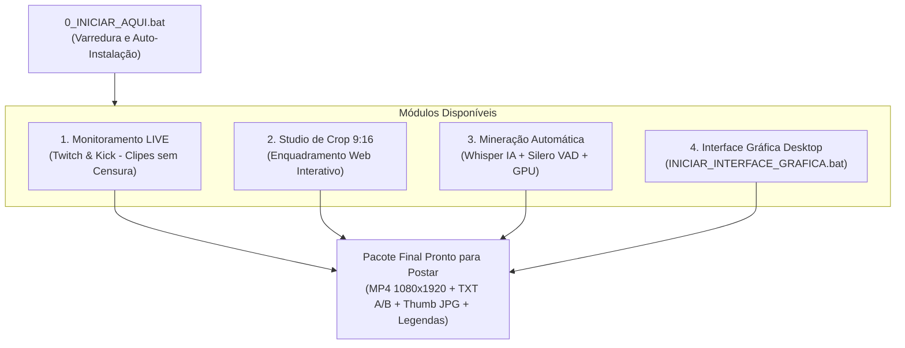

# Skill: Cortes IA Pro (Automação de Cortes Virais)

Esta skill permite a qualquer agente autônomo ou usuário operar o ecossistema completo de produção de cortes verticais (Shorts, Reels, TikTok e Kwai) a partir de lives, podcasts e vídeos longos.

---

## ⚡ Varredura e Inicialização Automática em 1 Clique (Self-Healing Bootstrap)

O projeto foi projetado com **Zero Gargalos de Instalação**. Qualquer usuário do Windows ou agente de IA pode inicializar o sistema diretamente através do script de varredura:

```cmd
INSTALAR_DEPENDENCIAS.bat --auto
```
ou simplesmente dando dois cliques em **`0_INICIAR_AQUI.bat`** ou **`INICIAR_INTERFACE_GRAFICA.bat`**.

### Como a Varredura Funciona:
1. **Verificação de Python:** Detecta automaticamente o Python 3.10+ no sistema. Se não estiver instalado, utiliza o `winget` para instalação silenciosa e sem atritos.
2. **Verificação de FFmpeg:** Detecta se o FFmpeg está no PATH. Se não estiver, instala via `winget install Gyan.FFmpeg`.
3. **Isolamento de Ambiente (`.venv`):** Cria o ambiente virtual local automaticamente se for a primeira vez.
4. **Varredura de Integridade das Bibliotecas:**
   - **Na Primeira Vez:** Instala todos os pacotes do `requirements.txt` (`faster-whisper`, `fastapi`, `uvicorn`, `customtkinter`, `opencv-python`, `yt-dlp`).
   - **Nas Próximas Vezes:** Realiza uma **varredura relâmpago de menos de 1 segundo**. Ao confirmar que o ambiente está íntegro, pula a instalação e inicia o programa instantaneamente.

---

## 🎯 Arquitetura dos 3 Pilares + Interface Desktop



1. **Monitoramento LIVE (`1_MONITORAMENTO_LIVE.bat`):** Monitora transmissões da Twitch e Kick, escuta eventos e captura clipes gerados por espectadores instantaneamente sem censura, além de downloads em lote via Streamlink / yt-dlp.
2. **Studio de Enquadramento 9:16 (`2_STUDIO_CROP_CAPTURA.bat`):** Abre a aplicação web em `http://127.0.0.1:8765/studio` com caixas de arrastar e soltar para dimensionar webcam e jogo com preview vertical em tempo real.
3. **Minerador & Renderer GPU (`3_DOWNLOAD_E_MINERADOR.bat`):** Permite arrastar qualquer vídeo para minerar ganchos virais e renderizar cortes em lote a 50+ FPS com GPU AMD AMF ou NVENC.
4. **Interface Gráfica Desktop (`INICIAR_INTERFACE_GRAFICA.bat`):** Interface nativa em CustomTkinter para seleção manual de arquivos, escolha entre 6 layouts visuais, controle de volume ducking e barra de progresso em tempo real.

---

## 🚀 Como Agentes de IA Devem Executar Este Módulo

### 1. Garantir que o Ambiente Está Íntegro (Auto-Check)
Antes de invocar o pipeline em uma máquina virgem:
```powershell
cmd /c "INSTALAR_DEPENDENCIAS.bat --auto"
```

### 2. Mineração e Processamento Autônomo via Python SDK
```python
from pathlib import Path
from core.pipeline import processar_video_completo

resultado = processar_video_completo(
    caminho_video=Path("gravacoes/live_streamer.mp4"),
    qtd_cortes=10,
    duracao_corte=60.0,
    gerar_legendas=True,
    ducking_ativo=True,
    whisper_model="medium",         # Modelo de alta precisão vocal
    layout_tipo="BLUR_BACKGROUND",  # Opções: 'SPLIT_SCREEN', 'FULL_BLEED_ZOOM', 'DUAL_FOCUS', 'BLUR_BACKGROUND'
    resolucao="1080p"               # 1080x1920 Full HD Vertical
)

print(f"Vídeos gerados em: {resultado['pasta_destino']}")
```

### 3. Recriação com Ajustes de Legenda e Título
Se o agente ou o usuário ajustar o arquivo `.txt` companion de algum corte:
```python
from pathlib import Path
from core.pipeline import recriar_corte_a_partir_do_txt

recriar_corte_a_partir_do_txt(Path("cortes_output/corte_01.txt"))
```

---

## 🎨 Modos de Layout e Enquadramento Suportados

| Identificador | Nome Visual | Descrição Técnica | Ideal Para |
| :--- | :--- | :--- | :--- |
| `BLUR_BACKGROUND` | Fundo Desfocado | Vídeo centralizado em Full HD com topo e rodapé preenchidos pelo fundo desfocado (Boxblur + brilho -15%) | Filmes, cinema, trailers e clipes horizontais |
| `SPLIT_SCREEN` | Split Screen | Webcam no terço superior (38%) e Gameplay/Tela no terço inferior (62%) | Streamers de jogos (GTA, Valorant, CS, etc.) |
| `FULL_BLEED_ZOOM` | Tela Cheia Adaptativa | Zoom inteligente centralizado preenchendo 100% da tela 9:16 sem bordas pretas | Podcasts em estúdio, vlogs e documentários |
| `DUAL_FOCUS` | Dual Focus | Foco duplo simultâneo no apresentador e convidado | Podcasts com duas câmeras |
| `STUDIO` | Studio Interativo | Coordenadas customizadas `(cam_x, cam_y, cam_w, cam_h)` e `(game_x, game_y, game_w, game_h)` definidas pelo usuário | Streams com overlays personalizados |

---

## 🎙️ Inteligência Vocal e Tratamento de Áudio

- **Modelo Whisper:** `medium` (padrão de alta fidelidade em português PT-BR) com fallback para `base`.
- **VAD Silero:** Ativo por padrão (`vad_filter=True`) para suprimir ruídos de fundo e respirações.
- **Filtro Vocal:** Passa-alta 80Hz + compressão vocal dinâmica de estúdio via FFmpeg.
- **Normalização EBU R128:** Padronizado para **-14 LUFS** (otimizado para o algoritmo do Shorts/Reels/TikTok).

---

## 📦 Entrega dos 5 Arquivos por Corte

Para cada corte gerado, o pipeline entrega:
1. `corte_XX_slug.mp4`: Vídeo vertical 9:16 renderizado com GPU.
2. `corte_XX_slug.txt`: Livro de publicação (3 títulos A/B, descrições prontas para Shorts/TikTok/Kwai e hashtags não-repetitivas).
3. `corte_XX_slug_thumb.jpg`: Capa de alta definição capturada no ápice da ação.
4. `corte_XX_slug.ass`: Legendas dinâmicas estilo MrBeast (terço inferior seguro).
5. `corte_XX_slug.srt`: Legenda universal SubRip sincronizada.

---

## 🛠️ Requisitos Mínimos

- **SO:** Windows 10/11 ou Linux.
- **Python:** 3.10+ (instalado automaticamente via `winget` se ausente).
- **FFmpeg:** Obrigatório no PATH (instalado automaticamente via `winget` se ausente).
- **Placa de Vídeo (GPU):**
  - AMD: Radeon RX com AMF (`h264_amf`)
  - NVIDIA: GeForce GTX/RTX com NVENC (`h264_nvenc`)
  - Fallback CPU: Multicore `libx264` automático se não houver placa dedicada.
